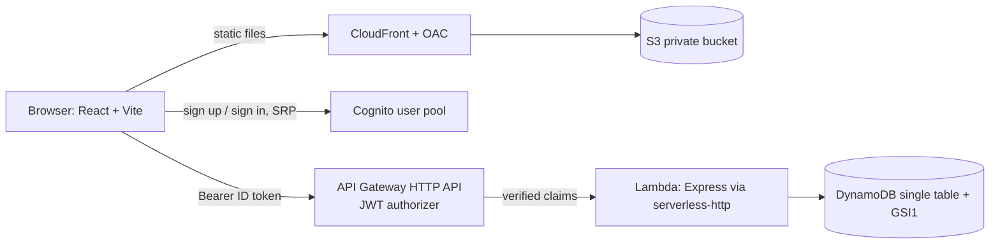

# Margin: serverless blog platform (Day 3)

A small publishing platform. Anyone can read. Signed-in users write stories and comment. Members of the Cognito `admins` group moderate.

**Cost: $0 on the AWS free tier.** Cognito, Lambda, HTTP API, DynamoDB (on-demand), S3 and CloudFront all stay inside free allowances at demo scale.

## Architecture



| Layer | Service | Notes |
|---|---|---|
| Frontend | S3 + CloudFront (OAC) | Bucket stays private. HashRouter means no rewrite rules |
| Auth | Cognito user pool, app client without secret | Group `admins` for moderators |
| API | HTTP API with a JWT authorizer | Public: `GET` posts. Everything else needs a token |
| Compute | Lambda running Express | Reads author from token claims, never from the request body |
| Data | DynamoDB, on-demand | Single-table design |

### Table design

| Item | PK | SK | Other |
|---|---|---|---|
| Post | `POST#<id>` | `META` | `GSI1PK=POSTS`, `GSI1SK=<createdAt>` |
| Comment | `POST#<id>` | `COMMENT#<timestamp>_<rand>` | |

One `Query` on `PK` returns a post with all its comments in order. The feed is a `Query` on `GSI1` with `ScanIndexForward=false`.

### API

| Method and path | Auth | Who may do it |
|---|---|---|
| `GET /api/posts` | none | anyone |
| `GET /api/posts/{id}` | none | anyone |
| `GET /api/me` | token | signed-in user |
| `POST /api/posts` | token | signed-in user |
| `PUT` / `DELETE /api/posts/{id}` | token | author or `admins` |
| `POST /api/posts/{id}/comments` | token | signed-in user |
| `DELETE /api/posts/{id}/comments/{commentId}` | token | comment author or `admins` |

## Run it locally (no AWS account needed)

Requirements: Node.js 20+. Use two terminals.

```bash
# Terminal 1: API on http://localhost:3001
cd backend
npm install
npm run dev
```

```bash
# Terminal 2: web app on http://localhost:5173
cd frontend
npm install
npm run dev
```

Open http://localhost:5173. The app starts in **demo mode**: sign-in is simulated (pick a name, optionally tick "moderator"), and data lives in `backend/.local-data.json`. Two sample stories are seeded on first run.

Things to try: write a story, sign out, sign in under another name and confirm you cannot edit it, then sign in as a moderator and remove a comment.

### Local with real Cognito (after you deploy once)

1. `backend/.env`: copy `.env.example`, set `USER_POOL_ID` and `CLIENT_ID`. The local API then verifies real Cognito ID tokens.
2. `frontend/.env`: copy `.env.example`, set `VITE_USER_POOL_ID` and `VITE_CLIENT_ID`.
3. Restart both dev servers. Sign up with a real email and confirm with the emailed code.

### Optional: local API against real DynamoDB

Set `TABLE_NAME` (and `AWS_REGION`) in `backend/.env`. For DynamoDB Local in Docker, also set `DYNAMODB_ENDPOINT=http://localhost:8000` and create the table with the same keys and `GSI1` as in `template.yaml`.

## Deploy

Prerequisites: AWS CLI v2 and SAM CLI configured for your admin user, region `ap-south-1`.

```bash
sam build
sam deploy --guided      # stack name: day03-blog, accept defaults
```

Copy the stack outputs (`ApiUrl`, `UserPoolId`, `UserPoolClientId`, `SiteBucketName`, `DistributionId`, `SiteUrl`), then:

```bash
cd frontend
# create .env.production with the three values
#   VITE_API_URL=<ApiUrl>
#   VITE_USER_POOL_ID=<UserPoolId>
#   VITE_CLIENT_ID=<UserPoolClientId>
npm run build
aws s3 sync dist/ s3://<SiteBucketName> --delete
aws cloudfront create-invalidation --distribution-id <DistributionId> --paths "/index.html"
```

Open `SiteUrl`. To make yourself a moderator:

```bash
aws cognito-idp admin-add-user-to-group --user-pool-id <UserPoolId> \
  --username <your-email> --group-name admins
```

Sign out and back in so the new ID token carries the group.

Clean up when done and screenshotted: `sam delete` (empty the S3 bucket first).

## Security notes

- The authorizer is the first gate: forged or expired tokens never reach Lambda.
- Lambda is the second gate: it checks ownership or the `admins` group. Authentication is not authorization.
- `authorId` and `authorName` come from token claims only.
- The Lambda role can only touch this table and `GSI1`. No `*` resources.
- CORS allows the CloudFront domain plus `http://localhost:5173` (parameter `ExtraAllowedOrigin`). Set the parameter to the CloudFront URL to drop localhost.
- Story text is rendered as plain text by React, so pasted HTML or scripts are never executed.
- Demo tokens (`dev:name:role`) are ignored on Lambda, so they cannot be used against the deployed API.

## Exam notebook (the three questions)

1. **Why this service over the obvious one?** DynamoDB over RDS: key-based access patterns, no connection pooling issues from Lambda, free on-demand tier. Cognito over hand-written JWT: managed credentials, MFA and group claims.
2. **What breaks at 100x traffic?** Feed `Query` on a single `GSI1` partition key becomes a hot partition. Shard the key (`POSTS#0..N`) or cache the feed in CloudFront.
3. **Cheapest further cut?** Cache `GET /api/posts` at CloudFront with a short TTL so most reads never reach Lambda or DynamoDB.

Concepts practiced: user pools vs identity pools, JWT authorizers, token claims, single-table design, GSI, least-privilege execution role, OAC, CORS.
